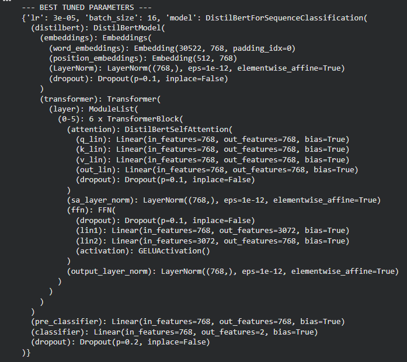
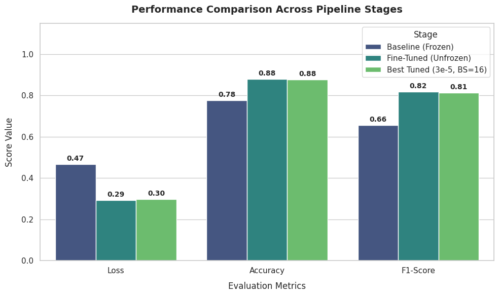

# Assignment 03: Transfer Learning, Fine-Tuning, Hyperparameter Tuning, and Interpretability

**Name:** Sumaiya
**Student ID:** 1000129288
**Program:** Skills for Industry Competitiveness and Innovation Program (SICIP), BRAC University
**Notebook:** `SICIP_Assignment_03.ipynb`

---

## 1. Task

Classify a user comment as **Toxic** or **Not Toxic**. The classifier is trained and evaluated on the Civil Comments dataset and then tested on real-world sentences. The pipeline has four phases:

1. Transfer learning (frozen pre-trained encoder, baseline)
2. Fine-tuning (whole model unfrozen)
3. Hyperparameter tuning (grid search on the fine-tuned model)
4. Interpretability (LIME explanations for selected predictions)

---

## 2. Data

| Item | Value |
| :--- | :--- |
| Source | `google/civil_comments`, `train` split, loaded with `load_dataset` |
| Pool | First 50,000 rows of the train split |
| Label rule | `toxicity >= 0.5` → Toxic (1); `toxicity < 0.5` → Not Toxic (0) |
| **Threshold** | **0.5** |
| Subset | All 3,303 toxic comments in the pool + 6,606 randomly sampled non-toxic comments (`random_state=42`), ratio 1:2 |
| Split | Shuffled, then 80/20 train/validation |
| Train | 7,927 comments (5,276 Not Toxic, 2,651 Toxic) |
| Validation | 1,982 comments (1,330 Not Toxic, 652 Toxic) |
| Tokenization | `max_length=128`, truncation, dynamic padding |

The full dataset is about 8% toxic at threshold 0.5, so I reduced it to a 1:2 subset to keep training stable and fast on a Colab T4 GPU. Even after this, a model that always predicts "Not Toxic" would get **67.1% accuracy** on the validation set. For that reason I treat **F1 on the Toxic class** as the main metric and report accuracy only as a secondary number.

---

## 3. Model Choice: `distilbert-base-uncased`

- DistilBERT is a distilled version of BERT with 6 transformer layers instead of 12 (about 66M parameters). The original paper reports that it keeps about 97% of BERT's GLUE performance while being about 40% smaller and 60% faster.
- The speed mattered here. The assignment needs one frozen run, one full fine-tuning run, and several tuning runs. With DistilBERT, each full fine-tuning run took roughly 5 to 7 minutes on a T4, so the whole pipeline fits in one Colab session.
- The uncased variant ignores capitalization. Online comments use capitals inconsistently, so this reduces noise, at the cost of losing "shouting" in all caps as a signal.

---

## 4. Pipeline Configuration

Common settings: `weight_decay=0.01`, 3 epochs, evaluation every epoch, `load_best_model_at_end=True` with validation F1 as the selection metric. Seeds set with `torch.manual_seed(42)` and `np.random.seed(42)`.

| Phase | What is trained | Learning rate | Batch size |
| :--- | :--- | :---: | :---: |
| 1. Transfer learning | Classification head only (`pre_classifier` + `classifier`, about 0.59M parameters). DistilBERT encoder frozen with `requires_grad=False`. | 2e-3 | 16 |
| 2. Fine-tuning | All layers (about 67M parameters) | 2e-5 | 16 |
| 3. Hyperparameter tuning | All layers, grid search | {1e-5, 3e-5} | {16, 32} |

The frozen baseline uses a much larger learning rate because only a small, freshly initialized head is being trained. Fine-tuning uses 2e-5, the usual range for BERT models, so the pre-trained weights are not overwritten too fast.

---

## 5. Results

### 5.1 Phase 1: Frozen baseline (per epoch, validation)

| Epoch | Training loss | Validation loss | Accuracy | F1 (Toxic) |
| :---: | :---: | :---: | :---: | :---: |
| **1** | 0.5744 | **0.4674** | **77.70%** | **65.63%** |
| 2 | 0.4012 | 0.4493 | 79.11% | 64.74% |
| 3 | 0.3812 | 0.4436 | 78.71% | 65.07% |

Best checkpoint by F1: epoch 1.

### 5.2 Phase 2: Fine-tuned model (per epoch, validation)

| Epoch | Training loss | Validation loss | Accuracy | F1 (Toxic) |
| :---: | :---: | :---: | :---: | :---: |
| **1** | 0.3368 | **0.2920** | **87.84%** | **81.78%** |
| 2 | 0.1859 | 0.3143 | 87.44% | 80.83% |
| 3 | 0.0950 | 0.4004 | 86.68% | 79.94% |

Best checkpoint by F1: epoch 1.

### 5.3 Frozen baseline vs. fine-tuned model

| Metric | Baseline (Frozen) | Fine-Tuned (LR 2e-5, BS 16) | Change |
| :--- | :---: | :---: | :---: |
| Validation loss | 0.4674 | 0.2920 | −0.1754 |
| Accuracy | 77.70% | 87.84% | +10.14 pp |
| F1 (Toxic) | 65.63% | 81.78% | **+16.15 pp** |

**Why fine-tuning wins by this much:**

- In the frozen run, DistilBERT's sentence representations come straight from pre-training on general text (masked language modelling). They encode grammar and topic well, but they were never shaped to separate insults from ordinary criticism. The head can only draw a boundary in that fixed space.
- The frozen model reaches 77.7% accuracy, which is about 10.6 points above the 67.1% majority-class level, so the pre-trained features do carry useful signal. But its F1 stays near 65% because it misses many toxic comments.
- When all layers are trained, the attention layers and token representations adapt to the task. This is where most of the gain comes from: F1 rises by about 16 points.
- Fine-tuning also overfits quickly. Training loss falls from 0.34 to 0.10 over three epochs, while validation loss rises from 0.29 to 0.40 and F1 drops slightly. Epoch 1 is the best checkpoint. Keeping `load_best_model_at_end=True` was therefore important.

### 5.4 Phase 3: Hyperparameter tuning

Searched: learning rate {1e-5, 3e-5} × batch size {16, 32}, 3 epochs each, full grid (4 runs). Each run keeps its best epoch by validation F1.

| Learning rate | Batch size | Best epoch | Validation loss | Accuracy | F1 (Toxic) |
| :---: | :---: | :---: | :---: | :---: | :---: |
| 1e-5 | 16 | 2 | 0.3071 | 87.49% | 81.04% |
| 1e-5 | 32 | 2 | 0.3097 | 87.24% | 80.79% |
| **3e-5** | **16** | **1** | **0.2962** | **87.64%** | **81.37%** |
| 3e-5 | 32 | 2 | 0.3046 | 87.64% | 81.08% |

Screenshot of the tuning run output:



### 5.5 All three stages

| Metric | Baseline (Frozen) | Fine-Tuned (LR 2e-5, BS 16) | Best Grid Config (LR 3e-5, BS 16) |
| :--- | :---: | :---: | :---: |
| Validation loss | 0.4674 | **0.2920** | 0.2962 |
| Accuracy | 77.70% | **87.84%** | 87.64% |
| F1 (Toxic) | 65.63% | **81.78%** | 81.37% |



**Justification of the tuning results:**

- The grid search did not beat the untuned fine-tuned model. The best grid configuration (LR 3e-5, BS 16) scored 81.37% F1, which is 0.42 points below the Phase 2 model at LR 2e-5.
- All five fine-tuned configurations (the four grid runs plus Phase 2) land between 80.8% and 81.8% F1. A spread of about 1 point is close to what a different random seed alone can produce, so none of these configurations is clearly better than the others.
- The default 2e-5 sits in the middle of the searched range (1e-5 to 3e-5). The grid tested values on both sides of it and found nothing better, which suggests 2e-5 is already near the best value for this data and model.
- Learning rate changes *when* the model peaks. At 3e-5 the BS 16 run peaks at epoch 1 and then overfits hard (validation loss 0.30 → 0.34 → 0.46). At 1e-5, both runs peak at epoch 2 and degrade more slowly.
- Batch size 16 was slightly better than 32 at both learning rates. With fewer examples per step, there are twice as many updates per epoch, which helps on a dataset of only 7,927 training comments.
- **Conclusion:** for this task, unfreezing the encoder matters far more than the exact learning rate or batch size. The model selected by the grid (LR 3e-5, BS 16) is the one used for the real-world test and LIME below. Its validation performance is within 0.5 points of the Phase 2 model.

---

## 6. Real-World Text Test

Model: best grid configuration (LR 3e-5, BS 16).

| # | Input | Predicted class | P(Not Toxic) | P(Toxic) | Check |
| :---: | :--- | :--- | :---: | :---: | :--- |
| 1 | "I absolutely hate this product. It is garbage and the developers are idiots." | **Toxic** | 0.0314 | **0.9686** | Correct. The sentence calls people "idiots", which is a direct insult. Strong criticism of a product alone would be borderline, but insulting the developers makes it toxic under the Civil Comments definition. |
| 2 | "The presentation was really clean and informative. Thank you for putting this together!" | **Not Toxic** | **0.9817** | 0.0183 | Correct. Polite, positive feedback with no insult, threat, or offensive language. |

---

## 7. Interpretability: LIME

### 7.1 Why LIME

- **Model-agnostic:** LIME only needs a function that maps raw text to class probabilities. I wrapped the tokenizer and model in `predict_probs()` and passed it directly, with no changes to the model.
- **Word-level output:** it returns a weight per word, which is easy to read and to check against intuition.
- **Cheaper than SHAP** for a transformer on Colab. SHAP's text explainers need many more model calls to be stable.
- **Attention weights were not used** because attention shows where the model looked, not which words changed the prediction. Several studies show attention weights can disagree with the features that actually drive the output.

Settings: `LimeTextExplainer(class_names=["Not Toxic", "Toxic"])`, `num_features=6`, default 5,000 perturbed samples. Positive weight pushes toward **Toxic**, negative weight pushes toward **Not Toxic**.

### 7.2 Example 1: Toxic comment (P(Toxic) = 0.9686)

| Word | LIME weight |
| :--- | :---: |
| idiots | +0.3279 |
| garbage | +0.2487 |
| hate | +0.0639 |
| product | +0.0143 |
| absolutely | −0.0175 |
| I | −0.0305 |

- "idiots" and "garbage" together account for most of the toxic prediction. These are the two words a human annotator would point to.
- "hate" contributes much less than the two insults (+0.06 vs. +0.33). The model appears to treat "I hate this product" as an opinion rather than as abuse, which is a sensible distinction.
- Neutral words like "I" and "absolutely" have small negative weights. They do not matter much for the decision.

### 7.3 Example 2: Non-toxic comment (P(Toxic) = 0.0183)

| Word | LIME weight |
| :--- | :---: |
| Thank | −0.0028 |
| presentation | −0.0028 |
| was | −0.0022 |
| for | −0.0009 |
| together | −0.0007 |
| clean | +0.0023 |

- All weights are very small (below 0.003). No single word is close to flipping the prediction. Removing any one word still leaves a clearly polite sentence, so the model stays confident.
- "Thank" and "presentation" push slightly toward Not Toxic, as expected.
- "clean" has a tiny positive (toxic-leaning) weight. This is probably noise, but it could also reflect that "clean" appears in toxic comments in phrases like "clean up this mess". At this magnitude it has no practical effect.

### 7.4 What the explanations show

The model bases its toxic decision on insulting words rather than on topic or sentence length, and it separates insults ("idiots") from strong negative opinion ("hate this product"). Two examples are a small sample, so this does not rule out known problems with toxicity models, such as over-flagging comments that only mention identity terms.

Note: LIME samples perturbations randomly and no `random_state` was set, so rerunning the cell gives slightly different weights. The ranking of the top words should stay the same.

---

## 8. Limitations

- **No separate test set.** The validation split was used both to pick the best epoch / configuration and to report the final numbers. This makes the reported scores slightly optimistic. The official `validation` and `test` splits of Civil Comments could be used as a held-out test set in future work.
- **Subset is not a random sample of the whole dataset.** The pool is the first 50,000 rows of the train split, and the 1:2 class ratio differs from the natural ~8% toxic rate. Precision on real traffic would likely be lower.
- **Single seed per configuration.** The differences between fine-tuned configurations (about 1 F1 point) are within likely seed-to-seed variation.
- **Small tuning grid.** Only learning rate and batch size were tuned; epochs, weight decay, warmup, and the decision threshold were fixed.

---

## 9. How to Run

1. Open `SICIP_Assignment_03.ipynb` in Google Colab and select a GPU runtime (Runtime → Change runtime type → T4 GPU).
2. Run all cells from top to bottom. The first cell installs the dependencies:
   ```bash
   pip install datasets transformers evaluate accelerate lime
   ```
3. Total runtime on a T4 is about 35 minutes (frozen ~3 min, fine-tuning ~7 min, grid search ~24 min).

---

## 10. Repository Structure

```
├── SICIP_Assignment_03.ipynb   # Full pipeline with outputs
├── README.md                   # This report
├── requirements.txt            # Python dependencies
├── .gitignore                  # Excludes checkpoints, data, caches
└── images/
    ├── tuning_results.png      # Screenshot of hyperparameter search output
    └── comparison_plot.png     # Bar chart of the three stages
```

The dataset and model checkpoints are not included. The dataset is downloaded from Hugging Face at runtime.
